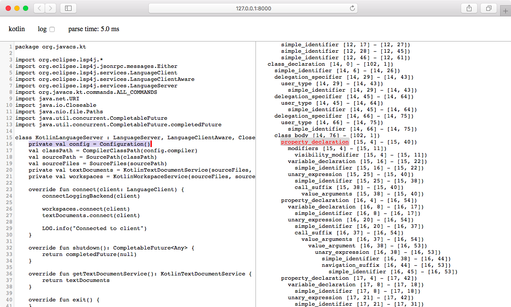

# Kotlin Grammar for Tree-sitter

[](https://github.com/fwcd/tree-sitter-kotlin/actions/workflows/build.yml)
[](https://www.npmjs.com/package/tree-sitter-kotlin)
[](https://crates.io/crates/tree-sitter-kotlin)

[Kotlin](https://kotlinlang.org) language grammar for [Tree-sitter](http://tree-sitter.github.io/tree-sitter/). You can try it out directly [on the web](https://fwcd.github.io/tree-sitter-kotlin).


The grammar is based on the [official language grammar](https://kotlinlang.org/docs/reference/grammar.html).

## Project Structure

| File | Description |
| ---- | ----------- |
| grammar.js | The Tree-sitter grammar |
| grammar-reference.js | A direct translation of the Kotlin language grammar that is, however, ambiguous to Tree-sitter |
| src | The generated parser |
| tools/ | Vendoring and cross-validation tooling |
| tools/vendor-fixtures.js | Fetch JetBrains PSI test fixtures at a pinned commit |
| tools/vendor-jetbrains-tests.js | Generate tree-sitter corpus tests from vendored fixtures |
| tools/cross-validation/ | Structural comparison against JetBrains PSI reference parser |
| tools/cross-validation/.fixtures-version | Pinned JetBrains/kotlin commit hash for reproducible vendoring |
| tools/cross-validation/fixtures.manifest.json | Imported fixtures and hash-scoped policy exclusions |
| tools/cross-validation/TODO.md | Categorized grammar issues with fix instructions |
| test/corpus/jetbrains/ | Generated structural tests and explicit expected-error cases |
| test/jetbrains-fixtures.json | Suite provenance, exclusions and remaining parser failures |

## Setup

>`npm install`

## Development

### Compilation

To (re-)compile the grammar, run:

>`npm run generate`

Note that the grammar is written completely in JavaScript (`grammar.js`), the other source files are generated by `tree-sitter`.

### Testing

To run the unit tests, run:

>`npm run test`

It is also helpful to run the parser on a real Kotlin project's source files.

```shell
./node_modules/.bin/tree-sitter parse "/path/to/some/project/**/*.kt"  --quiet --stat
```

## JetBrains PSI fixtures

The test suite imports whole-file Kotlin sources, `.kts` scripts and linked spec
cases from [JetBrains/kotlin](https://github.com/JetBrains/kotlin) at Kotlin
2.4.21, commit `9180ce6a7a7d3627f88b424717583f28ddca052d`.

Of789 source/golden pairs,342 contain `PsiErrorElement` nodes and are filtered
out automatically. The 447 PSI-clean pairs have 438 eligible suite inputs and
nine recorded exclusions: two concatenated multi-file cases and seven cases
using unsupported experimental companion-block or ContractSyntaxV2 syntax.
Every exclusion records its reason, upstream paths and exact source/golden
hashes in `tools/cross-validation/fixtures.manifest.json`. The original excluded
pairs are retained under the fixture directory's `.context-exclusions/` for
inspection. Relative paths and namespaces preserve colliding filenames.

All 438 eligible inputs are checked into `test/corpus/jetbrains/`:

- 399 parse-clean fixtures have structural CST expectations.
- 39 remaining parser failures use Tree-sitter's explicit `:error` attribute.
  They run in CI and are listed in `test/jetbrains-fixtures.json`; they are not
  skipped. A fixture that starts parsing cleanly fails its error expectation
  until regeneration promotes it to a structural test.

PSI-clean means the reference parser produced no syntax-error nodes. Some
fixtures still exercise semantic diagnostics or permissive recovery; acceptance
here is not a claim that every source compiles.

```sh
npm run vendor-fixtures
npm run vendor-jetbrains
npm test
npm run cross-validate:test
npm run cross-validate

# Reuse a local clone containing the exact JetBrains pin.
npm run vendor-fixtures -- --source-repo /path/to/kotlin
```

The importer preserves `.kts` extensions, filters errors from the golden rather
than filenames, and applies the pinned upstream metadata preprocessing to spec
sources. The manifest verifies membership, policy records, content and
provenance. The generator uses the native binding's `rootNode.hasError` and
retains previous generated trees under `build/jetbrains-corpus-backups/`.

After a grammar fix, regenerate the suite and review the fixture's transition
from expected error to structural expectation. Updating the JetBrains pin also
requires reviewing any hash-scoped policy whose input changes. See
[tools/README.md](tools/README.md) for the import policy and regeneration steps.


## WebAssembly

### Compilation

First make sure to have [Emscripten](https://emscripten.org/) installed. If you use Homebrew, you can `brew install emscripten`. Then run:

>`npm run build-wasm`

### Playground

After compiling the grammar to WebAssembly, you can invoke

>`npm run playground`

to launch an interactive editing environment that displays the parsed syntax tree on-the-fly in the browser. You can also view a deployed version of this playground [on the web](https://fwcd.github.io/tree-sitter-kotlin).



## Documentation

More documentation on how to create Tree-sitter grammars [can be found here](https://tree-sitter.github.io/tree-sitter/creating-parsers).

## See also

* [Kotlin Language Server](https://github.com/fwcd/kotlin-language-server) for code completion, diagnostics and more
* [Kotlin Debug Adapter](https://github.com/fwcd/kotlin-debug-adapter) for JVM debugging support
